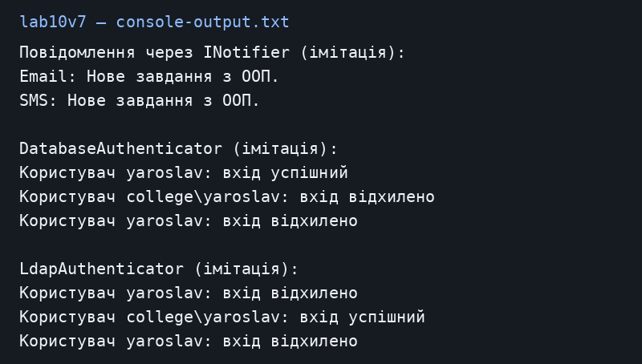

# Лабораторна робота №6

Загоровський Ярослав Віталійович, ІПЗ 3/1. Варіант 7.

Тема: Інтерфейси та абстрактні класи.

Репозиторій: https://github.com/Yariker9039/OOP-Zahorovskiy

## Що зроблено

Я зробив INotifier з методом SendNotification. Його реалізують EmailNotifier і SmsNotifier. Абстрактний Authenticator містить Authenticate без реалізації та готовий LogAttempt. DatabaseAuthenticator і LdapAuthenticator по-різному перевіряють тестові облікові записи. У Main є колекції обох базових типів і приклади вдалих та невдалих входів. База й LDAP імітуються словниками в пам’яті. Паролі тут навчальні; це не реалізація справжньої системи входу. Назва lab10v7 відповідає методичці лабораторної 6.

## Запуск

Потрібен .NET SDK 10. З кореня репозиторію:

```powershell
dotnet run --project lab10v7
```

## Результат запуску

[Текст консолі](console-output.txt).



## Контрольні питання

**1. Чим відрізняються абстрактний клас та інтерфейс?**

Абстрактний клас може мати поля, конструктор і спільний код. Інтерфейс задає, які дії повинен підтримувати клас. У сучасному C# інтерфейс також може містити реалізації за замовчуванням, але тут цього немає.

**2. Коли обирати кожен із них?**

Інтерфейс зручний для спільної дії різних класів, як надсилання повідомлень. Абстрактний клас зручний, коли споріднені класи мають спільний код, як LogAttempt.

**3. Чи можна успадкувати кілька класів?**

Ні, клас C# має лише один безпосередній базовий клас. Зате він може реалізовувати кілька інтерфейсів.

**4. Як вони допомагають поліморфізму?**

Код працює з INotifier або Authenticator, а конкретний об’єкт виконує власну реалізацію. Новий різновид можна додати без переписування основного циклу.

## Висновок

Інтерфейс задав спільний метод для сповіщень. Абстрактний клас дозволив залишити перевірку входу різною, а запис результату використати спільний.
