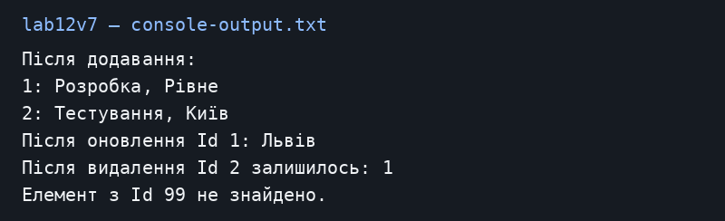

# Лабораторна робота №7

Загоровський Ярослав Віталійович, ІПЗ 3/1. Варіант 7.

Тема: Узагальнений репозиторій та тести.

Репозиторій: https://github.com/Yariker9039/OOP-Zahorovskiy

## Що зроблено

Я створив Department із властивостями Id, Name та Location. IEntity вимагає Id. IRepository<T> задає додавання, читання, оновлення й видалення. InMemoryRepository<T> виконує ці дії зі списком у пам’яті. Обмеження where T : IEntity дає змогу звертатися до Id. Якщо Id немає, GetById, Update і Delete кидають KeyNotFoundException. Повторне додавання того самого Id заборонене. GetAll повертає копію списку, але самі об’єкти залишаються спільними; Id після додавання не слід змінювати. Оновлення в прикладі виконано окремим об’єктом із тим самим Id. Назва lab12v7 відповідає методичці лабораторної 7.

## Запуск

Потрібен .NET SDK 10. З кореня репозиторію:

```powershell
dotnet run --project lab12v7
```

Тести розміщено в [lab12v7.Tests](../lab12v7.Tests).

```powershell
dotnet test lab12v7.Tests
```

## Результат запуску

[Текст консолі](console-output.txt).



## Контрольні питання

**1. Для чого where?**

Воно обмежує допустимі типи. Where T : IEntity вимагає наявності Id, where T : class допускає посилальні типи, а where T : new() вимагає відкритого конструктора без параметрів.

**2. Навіщо IRepository?**

Щоб код працював зі спільними операціями над даними. Реалізацію збереження можна замінити, не переписуючи весь код, який використовує інтерфейс.

**3. Навіщо тести узагальнених компонентів?**

Одна помилка в репозиторії може зачепити всі типи, які його використовують. Тести перевіряють звичайні дії й ситуації, коли запису немає.

**4. Чим generics кращі за object?**

Компілятор перевіряє типи: до репозиторію Department не можна додати рядок. Не потрібно щоразу приводити object до потрібного типу. Для значимих типів generics також можуть уникати boxing.

## Висновок

Один репозиторій може працювати з різними сутностями, які мають Id. Тести окремо перевіряють CRUD, відсутні записи, повторний Id та null.
