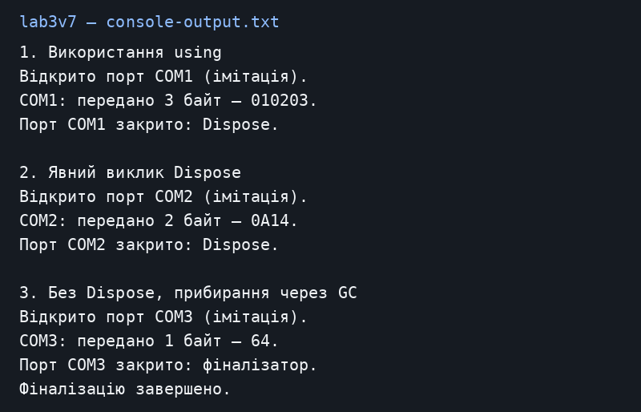

# Лабораторна робота №3

Загоровський Ярослав Віталійович, ІПЗ 3/1. Варіант 7.

Тема: Життєвий цикл об’єкта та звільнення ресурсів.

Репозиторій: https://github.com/Yariker9039/OOP-Zahorovskiy

## Що зроблено

Я зробив клас SerialPortConnection, який імітує COM-порт. Конструктор відкриває порт, SendData показує передані байти, а Dispose закриває його. Справжній порт не використовується. У Main є три способи завершити роботу з об’єктом: using, прямий виклик Dispose та фіналізатор. Після GC.Collect викликається GC.WaitForPendingFinalizers, щоб дочекатися фіналізатора.

## Запуск

Потрібен .NET SDK 10. З кореня репозиторію:

```powershell
dotnet run --project lab3v7
```

## Результат запуску

[Текст консолі](console-output.txt).



## Контрольні питання

**1. Що таке життєвий цикл об’єкта?**

Об’єкт створюється, використовується, а коли він стає недоступним, GC може звільнити його пам’ять. Для об’єкта з фіналізатором спочатку виконується фіналізація.

**2. Чим відрізняються керовані та некеровані ресурси?**

Пам’яттю звичайних об’єктів керує .NET. Файлові дескриптори та подібні системні ресурси потрібно закривати окремо. Наприклад, FileStream є керованим об’єктом, але утримує ресурс операційної системи.

**3. Для чого IDisposable?**

Він задає метод Dispose, через який об’єкт звільняє свої ресурси.

**4. Що робить using?**

Автоматично викликає Dispose при виході з блоку, навіть якщо виникла помилка.

**5. Навіщо GC.SuppressFinalize?**

Після Dispose прибирання вже виконано, тому фіналізатор для цього об’єкта більше не потрібен.

**6. Чому Dispose(true) та Dispose(false)?**

При true можна звільняти і керовані, і некеровані ресурси. При false прибирають лише власні некеровані ресурси: стан інших керованих об’єктів у фіналізаторі не гарантований. Тут порт лише імітується.

## Висновок

Using закриває порт автоматично. При явному Dispose потрібно самому пам’ятати про виклик. Фіналізатор — запасний варіант: час його запуску не визначений. GC.Collect використано тільки для демонстрації.

[Повний код і результат](REPORT.md).
