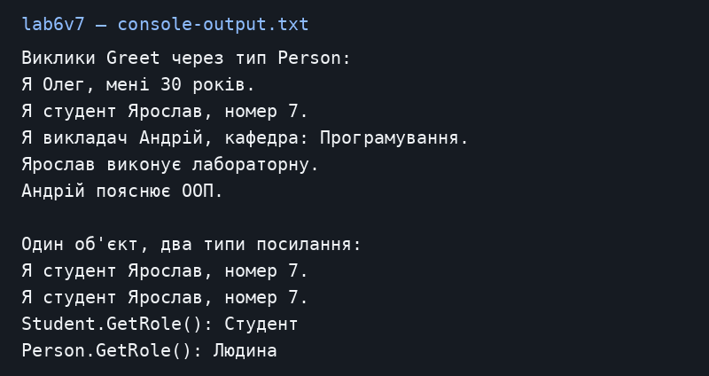

# Лабораторна робота №4

Загоровський Ярослав Віталійович, ІПЗ 3/1. Варіант 7.

Тема: Наслідування та різниця між override і new.

Репозиторій: https://github.com/Yariker9039/OOP-Zahorovskiy

## Що зроблено

Я створив Person, Student і Professor. У Person є ім’я, вік та метод Greet. Похідні класи мають свої привітання й окремі методи Study та Teach. Ланцюжок Person → Student → Professor залишено буквально як у варіанті методички. Для реальної системи викладача зазвичай робили б окремим нащадком Person. Назва lab6v7 відповідає вимогам лабораторної 4.

## Запуск

Потрібен .NET SDK 10. З кореня репозиторію:

```powershell
dotnet run --project lab6v7
```

## Результат запуску

[Текст консолі](console-output.txt).



## Контрольні питання

**1. Що таке наслідування?**

Новий клас отримує доступні поля, властивості й методи базового класу та додає свої. Наприклад, Student є різновидом Person.

**2. Для чого base?**

Base викликає конструктор або доступний метод базового класу. У Student виклик base(name, age) задає ім’я та вік.

**3. У чому різниця між virtual і override?**

Virtual дозволяє змінити метод у похідному класі. Override задає цю змінену версію. Навіть через посилання Person викликається Greet справжнього типу об’єкта.

**4. Коли використовують new?**

Коли потрібно окремо приховати успадкований метод. Виклик тоді залежить від типу змінної. Student.GetRole повертає «Студент», а Person.GetRole для того самого об’єкта — «Людина». Для звичайного поліморфізму краще override.

## Висновок

Override зберігає поведінку реального об’єкта навіть через базовий тип. New лише приховує метод, тому тип посилання впливає на результат.
