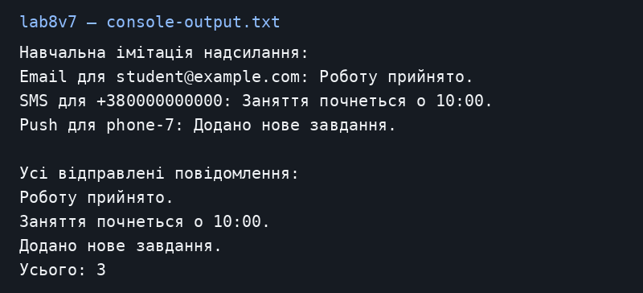

# Лабораторна робота №5

Загоровський Ярослав Віталійович, ІПЗ 3/1. Варіант 7.

Тема: Поліморфні повідомлення.

Репозиторій: https://github.com/Yariker9039/OOP-Zahorovskiy

## Що зроблено

Я створив Notification та три його різновиди: EmailNotification, SMSNotification, PushNotification. Усі вони мають Send, але кожен показує свій спосіб відправлення. Програма проходить один List<Notification>, викликає Send та збирає тексти у спільний список. Надсилання імітується в консолі. Назва lab8v7 взята з методички лабораторної 5.

## Запуск

Потрібен .NET SDK 10. З кореня репозиторію:

```powershell
dotnet run --project lab8v7
```

## Результат запуску

[Текст консолі](console-output.txt).



## Контрольні питання

**1. Що таке поліморфізм?**

Один виклик працює по-різному для різних об’єктів. Тут Send у базовому класі має virtual, а три похідні класи перевизначають його через override.

**2. Що таке динамічне зв’язування?**

Потрібна версія віртуального методу вибирається під час роботи програми за фактичним типом об’єкта. При статичному зв’язуванні вибір визначається під час компіляції.

**3. Як поліморфізм спрощує розширення?**

Можна додати новий клас повідомлення з власним Send і покласти його в список. Сам цикл надсилання змінювати не потрібно.

**4. Навіщо колекція базового типу?**

Вона дозволяє зберігати різні повідомлення разом і обробляти їх одним циклом без окремих перевірок кожного типу.

## Висновок

Один цикл викликав три різні реалізації Send. Після цього програма вивела список усіх трьох повідомлень і їхню кількість.
